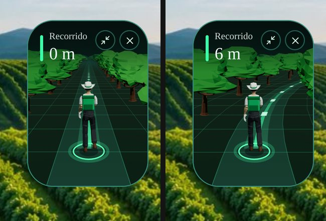
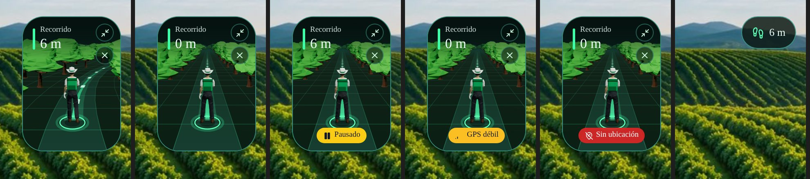
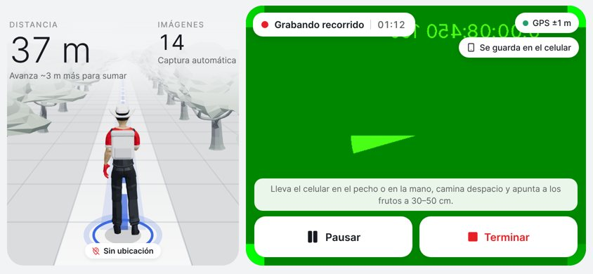
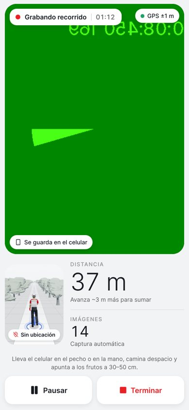

# AVOTEX Field Tracking 3D

Panel flotante en la pantalla de grabación del **Recorrido inteligente**: un agricultor visto desde atrás camina
por un camino agrícola entre filas de árboles hacia el horizonte, como las visualizaciones de los autos
inteligentes. Camina cuando el GPS confirma que el usuario camina, a una velocidad proporcional, y se detiene
cuando el usuario se detiene o pausa.





> Capturas de la build web con movimiento GPS simulado. La pantalla real muestra el panel sobre la cámara.

## Decisión técnica

| Opción | Veredicto |
|---|---|
| **A. three.js + expo-gl** | Descartada. El proyecto no tiene `expo-gl`, `expo-three` ni R3F; añadirlos exige una nueva build nativa y un contexto GL que compite con la vista previa de la cámara por la GPU en todo el recorrido. Un modelo riggeado + skinning a 20 FPS en gama baja pone en riesgo lo que no se puede tocar (cámara, captura, GPS). |
| three.js dentro del `WebView` existente | Descartada: un proceso de render Chromium completo (≈40–80 MB) solo para un panel de 125 dp. |
| **C + B. 3D prerenderizado + proyección en perspectiva en vivo** | **Elegida.** Sin dependencias nuevas ni build nativa nueva. |

Cómo funciona la opción elegida:

1. **Fuera de la app** (`scripts/field-tracking/render.mjs`, Chromium headless + three.js) se carga un modelo
   humano riggeado real (CC0), se anima sobre su esqueleto y se renderiza **desde la cámara virtual de la
   escena** (`scene.config.json`): 16 fotogramas de caminata + 8 de idle, árboles low-poly y el fondo con las
   filas lejanas. Total ≈ 90 KB de imágenes.
2. **En la app** (`components/fieldTracking/projection.ts`) se usa exactamente la misma cámara (altura 2.5 m,
   inclinación 15°, FOV 50°) para proyectar en vivo el camino, la cuadrícula, la trayectoria luminosa y los
   árboles cercanos. Por eso lo prerenderizado y lo dinámico encajan en perspectiva.
3. El suelo se desplaza a **la misma razón que el ciclo de caminata** (`metersPerCycle`, medido en el
   prerender a partir del pie de apoyo): los pies no patinan.

## Personaje

- Modelo «Farmer» de Quaternius (CC0, ≈5.5 k triángulos, 49 huesos): sombrero, camisa, overol/pantalón, botas.
- Se le añadieron mochila verde y celular en la mano derecha (con el brazo flexionado, apuntando a los árboles).
- El modelo no trae clips: `render.html` crea la caminata con cinemática directa (cadera con giro y báscula,
  rodilla que se flexiona en el balanceo, pie que recibe el paso, brazo libre en contrafase, torso que
  compensa) y apoya automáticamente el pie más bajo en el suelo en cada fotograma (sin flotar ni hundirse).
- Idle: respiración y cambio de peso (8 fotogramas, 2.6 s).
- Al detenerse, el paso en curso se termina hasta juntar los pies y entonces pasa a idle (sin cortes).

## Sincronización con el GPS real

`services/fieldMotion.ts` (`FieldMotion`) recibe **las mismas lecturas** que ya procesa el recorrido
(`onPosition` → `GpsTrack`): no hay un segundo observador de ubicación. Decide:

| Qué | Cómo |
|---|---|
| Caminar / quieto | Histéresis: arranca con 2 lecturas seguidas de velocidad Doppler ≥ 0.5 m/s (o un paso aceptado por `GpsTrack`); se detiene tras 2.5 s con < 0.3 m/s. Con precisión > 20 m el Doppler solo no basta. |
| Velocidad confiable | Se usa `GpsTrack.lastSpeed`: la velocidad del teléfono solo cuenta después de que demostró medir movimiento (Android manda `speed = 0` en lecturas sin velocidad). Sin ella, se usan los pasos aceptados. |
| Velocidad | Doppler suavizado (o la de los pasos aceptados si el teléfono no la da), limitada a 0.45–1.9 m/s: caminar rápido acelera el paso pero **nunca** se convierte en carrera. |
| Precisión | ≤ 12 m: buena · 12–50 m: «GPS débil» · > 50 m: se ignora (mismo límite que la distancia). |
| Lecturas que dejan de llegar | 4 s → se detiene · 9 s → «Sin ubicación». No se sigue avanzando indefinidamente. |
| Rumbo | Solo si es fiable (Doppler ≥ 0.6 m/s y precisión ≤ 15 m, o rumbo entre pasos aceptados de ≥ 3 m). Se convierte en curvatura del camino (radio mínimo ≈ 17 m) y se suaviza; si no es fiable, se relaja a recto. No se usa el magnetómetro. |
| Distancia | **No la calcula.** El panel muestra `stats.distance` (la de `GpsTrack`), igual que la tarjeta «Distancia». El desplazamiento visual del suelo es solo animación. |

En el hilo de UI, la velocidad visual se acerca a la objetivo con constante de tiempo 0.6 s (arranque) / 0.45 s
(frenado): interpolación suave entre lecturas sin inventar metros.

## Estados

| Estado | Escena |
|---|---|
| Grabando y caminando | Personaje caminando, suelo y árboles avanzando, trayectoria con destellos que fluyen. |
| Grabando y quieto | Sigue caminando a velocidad base (0.55 m/s). La distancia no cambia: solo cuenta el GPS. |
| Pausado | Escena congelada (el bucle de animación se apaga) + chip «Pausado». |
| GPS débil | Chip «GPS débil»; sin movimiento ficticio, se conserva la última escena válida. |
| Sin GPS / sin permiso | Escena estática + chip «Sin ubicación». |
| Terminado | El panel se desmonta con la pantalla de grabación y `FieldMotion` se libera en `stopSensors()`. |

## Pantalla de grabación (estilo Tesla)





- Inspirada en la pantalla de los Tesla: la **cámara es el «mapa»** (panel grande con tarjetas blancas encima:
  estado y tiempo, GPS, red) y el **agricultor 3D es el «auto»** (panel claro con la distancia grande, las
  imágenes y los botones blancos). Superficies claras (`#f2f3f5`), tipografía **Inter**, un solo acento rojo
  (agricultor, botón Terminar) y la ruta en azul (`#3e6ae1`).
- **Horizontal:** como en el Tesla, el agricultor ocupa **todo el alto y el 40 % del ancho**, con la distancia y
  las imágenes arriba; la cámara ocupa el 60 % con el consejo y los botones Pausar/Terminar abajo.
- **Vertical:** cámara arriba; abajo el agricultor en tamaño compacto (~124 × 170 dp) junto a los datos, y los
  botones.
- **«Gira tu celular»:** al iniciar el recorrido en vertical aparece una animación de un teléfono que gira con
  «Rota el dispositivo para una mejor experiencia». Se va sola al girar a horizontal, con «Continuar en
  vertical» o a los 10 s. La captura ya está corriendo detrás.
- El agricultor **siempre camina** desde el inicio (velocidad base 0.55 m/s) y acelera con la velocidad real del
  usuario. En pausa se congela. No se puede minimizar ni ocultar, y no intercepta toques.
- Si las imágenes no cargan o el render falla, el panel queda con el estado (sin escena) y el recorrido sigue.

## Rendimiento

- **Nada en el hilo JS por fotograma.** Un único `useFrameCallback` en el hilo de UI, limitado a 20/15/10 FPS
  según la calidad, escribe 3 valores compartidos (`travel`, `curv`, `frame`). React solo re-renderiza cuando
  cambia el estado GPS (≈1 vez por segundo, junto con el render que el cronómetro ya provocaba).
- Solo `transform`/`opacity` (árboles y sprite) y el atributo `d` de 5 trazos SVG. Sin layout por fotograma.
- Árboles en **ranuras fijas por profundidad**: el orden de pintado siempre es correcto sin `zIndex`; la variedad
  (tamaño, espejo) sale de un hash del árbol, sin cambiar imágenes.
- Recursos locales y pequeños (≈ 90 KB), sin descargas durante el recorrido.
- Se detiene por completo en pausa y en segundo plano (`AppState`).
- `FieldMotion` corre dentro del `onPosition` existente en un `try/catch`: un fallo nunca afecta la captura.

### Calidad adaptativa (`components/fieldTracking/quality.ts`)

| Nivel | FPS escena | Contenido |
|---|---|---|
| high | 20 | 2 filas de árboles por lado (28), cuadrícula completa, destellos de trayectoria |
| reduced | 15 | 1 fila por lado (12), sin destellos |
| light | 10 | Sin árboles dinámicos (quedan las filas lejanas del fondo), camino y trayectoria |
| off | — | No se usa por rendimiento: la degradación automática se detiene en «light». Solo si fallan las imágenes o el render, el panel queda sin escena. |

- Nivel inicial: < 2.5 GB de RAM → light; < 3.5 GB → reduced; equipo anterior a 2017 → reduced; modo de ahorro
  de energía o batería < 15 % sin cargar → light.
- En marcha: si el hilo de UI cae por debajo de ~25 FPS de media en dos ventanas seguidas de 3 s, baja un nivel
  (nunca sube solo, para no oscilar) y nunca por debajo de «light»: la animación siempre está activa.
- Si una imagen no carga → off. Si el render lanza una excepción, dos barreras de errores (`SceneBoundary` y
  `FieldTrackingGuard`) desactivan el panel y **el recorrido continúa**.

### Mediciones disponibles

| Medición | Resultado | Entorno |
|---|---|---|
| CPU del hilo principal, panel expandido caminando | 4.5 % (script 1.3 %, layout 0.12 %) | Chromium headless, build web (en web Reanimated corre en el hilo JS: cota superior) |
| CPU, panel minimizado / oculto | 0.1 % / 0.1 % | ídem |
| Heap JS adicional con el panel | +5 MB | ídem |
| Fotogramas de caminata distintos en 1.2 s a 1.2 m/s | 9 (el ciclo avanza) | ídem |
| Árboles al detenerse | 1 posición distinta en 1.5 s (inmóviles) | ídem |
| Recursos de la escena | ≈ 90 KB | — |

**No medido (requiere teléfono real):** FPS de la cámara antes/después, FPS de la escena en nativo, memoria y
CPU/GPU en Android/iOS, consumo de batería, estabilidad del intervalo de captura y número de fotos correctas.
Ver «Pruebas pendientes en dispositivo».

## Pruebas

### Automáticas

```bash
node --experimental-transform-types scripts/field-tracking/simulate-motion.test.ts
node --experimental-transform-types scripts/gps-distance.test.ts
```

Simulaciones con ruido gaussiano que pasan por el filtro real (`GpsTrack`) y luego por `FieldMotion` — 16/16 (los dos últimos: Android con `speed = 0` caminando y quieto):

1. Quieto con ruido ±5 m y Doppler bajo: nunca camina.
2. Quieto sin Doppler: < 3 % del tiempo en movimiento.
3. Caminata lenta 0.6 m/s: camina a ~0.6 y arranca en ≤ 4 s.
4. Caminata normal 1.2 m/s: velocidad ~1.2.
5. Caminata rápida 2.6 m/s: limitada a 1.9 (sin carrera).
6. Camina y se detiene: idle en ≤ 4 s.
7. GPS perdido: se detiene en ≤ 5 s y «Sin ubicación» en ≤ 10 s.
8. Precisión ±30 m: «GPS débil» sin movimiento.
9. Precisión ±18 m quieto con Doppler ruidoso: no arranca.
10. Salto de 80 m: sin picos de velocidad ni giros violentos.
11. Círculo de 20 m de radio: curvatura ≈ 1/20 a la derecha.
12. Recorrido de 8 m: camina y se detiene.
13. Recorrido de 40 min: estable.
14. `FieldMotion` no altera la distancia de `GpsTrack`.

Además: `tsc` sin errores nuevos; build web (`expo export --platform web`) y, sobre ella con Playwright:
caminar → detenerse, todos los estados visuales, minimizar → expandir → ocultar, sin errores de consola.

### Pendientes en dispositivo

Requieren un teléfono real (idealmente uno de gama baja y uno de gama media, en build de release):

- FPS de la vista previa de la cámara con el panel expandido vs. oculto.
- Intervalo y número de fotos de la captura automática en un mismo trayecto con el panel expandido y oculto.
- Caminata real lenta, normal y rápida; detenerse; pausar y seguir; tapar el cielo para degradar el GPS.
- Segundo plano y regreso; terminar el recorrido y abrir resultados.
- Batería en 20 min de recorrido con y sin panel.
- Que la degradación automática baje de nivel en el equipo más lento.

## Edificios y muros — evaluación

**No se implementó en esta versión.** Lo viable sería consultar edificios de OpenStreetMap (Overpass API,
`building=*` con `height`/`building:levels` cuando existen) **antes** de iniciar el recorrido y extruirlos como
volúmenes en la misma proyección. Motivos para dejarlo fuera:

- Es una consulta de red adicional y AVOTEX graba sin señal en la huerta; durante el recorrido no se deben hacer
  consultas geográficas.
- En huertas rurales de Michoacán la cobertura de edificios en OSM es escasa y casi nunca trae alturas: se
  mostrarían volúmenes inventados o nada.
- Leaflet solo muestra teselas raster; no aporta geometría ni alturas.
- Exigiría ordenar por profundidad polígonos arbitrarios en cada fotograma (más costo que los árboles).

Si se retoma: precargar en la preparación del recorrido, cachear por huerta, máximo ~20 volúmenes dentro de
60 m, solo con datos OSM reales y estilo claramente esquemático; la escena de huerta seguiría funcionando igual
sin ellos.

## Limitaciones

- El personaje es un sprite prerenderizado de una sola orientación (de espaldas); al girar, se curva el camino
  pero el cuerpo no rota.
- Los árboles son ilustrativos: no representan la posición real de cada árbol (solo conocemos el perímetro de
  la huerta). Lo que responde a datos reales es el estado de caminata, la velocidad, el giro y la distancia.
- 16 fotogramas por ciclo: a 10 FPS (modo ligero) la caminata se ve menos fluida.
- El costo real en el teléfono no se ha medido (ver arriba).

## Regenerar los recursos

```bash
npm i --prefix /tmp/ft three@0.170.0
# Descargar Farmer.glb y CommonTree_1/2/5.glb (ver assets/field-tracking/CREDITOS.md) en /tmp/ft/models
node scripts/field-tracking/render.mjs --three /tmp/ft/node_modules/three --models /tmp/ft/models
python3 scripts/field-tracking/optimize.py
```

Si cambia `scene.config.json`, hay que regenerar: la proyección en vivo lee los mismos valores desde
`assets/field-tracking/field-scene.json`.

## Archivos

| Archivo | Rol |
|---|---|
| `app/(app)/recorrido.tsx` | Crea `FieldMotion` al iniciar, lo alimenta desde `onPosition` y el tick de 1 s, lo libera al terminar; monta el panel y el botón 3D. |
| `services/fieldMotion.ts` | Estado de movimiento (caminar, velocidad, giro, calidad GPS). |
| `components/fieldTracking/FieldTracking3D.tsx` | Panel: estados, minimizar/expandir/ocultar, calidad, segundo plano, barreras de errores. |
| `components/fieldTracking/FieldScene.tsx` | Escena animada en el hilo de UI. |
| `components/fieldTracking/projection.ts` | Cámara virtual compartida con el prerender. |
| `components/fieldTracking/quality.ts` | Niveles de calidad. |
| `assets/field-tracking/*` | Sprite, árboles, fondo, metadatos y créditos. |
| `scripts/field-tracking/*` | Prerender, optimización y simulaciones. |

## Diagnóstico GPS

Durante la grabación, cada lectura GPS imprime una línea en la consola con el prefijo `[gps]` (no aparece en la
interfaz):

```
[gps] #13 ±8m v=0.00(no confiable) desp 12.4/10.0m → +12.4m · pasos 1 · rech prec 0 puerta 11 salto 0 idavuelta 0 · total 12.4m · 19.400143,-102.050018
```

| Campo | Significado |
|---|---|
| `±8m` | Precisión que reporta el teléfono. Lecturas peores que ±50 m se rechazan. |
| `v=` | Velocidad que da el teléfono (`sin dato` si no la da). `(no confiable)`: aún no demostró medir movimiento. |
| `quieto` | El Doppler confiable dice que no te mueves (la puerta sube a 25 m). |
| `desp 12.4/10.0m` | Desplazamiento suavizado desde el último punto aceptado / mínimo exigido (puerta). |
| `→` | Decisión: `+X m` sumados, o `rechazada(repetida · precisión · puerta · persistencia · salto · ida-vuelta)`. `repetida`: el teléfono repitió exactamente la misma coordenada (sin lectura nueva); al inicio, la píldora muestra «Buscando GPS…» mientras eso pase. |
| `total` | Distancia acumulada del recorrido. |

Dónde verlo: en la terminal de Metro (build de desarrollo); en Android con
`adb logcat -s ReactNativeJS`; en iOS con la app Consola de macOS filtrando por `[gps]`.

## Modos Dron y GoPro (acompañantes)

En Escanear, las tarjetas **Dron** y **GoPro** inician el mismo recorrido inteligente que Celular. La captura,
el GPS y los datos son idénticos (las fotos las toma el celular y el recorrido se guarda como siempre). Lo único
que cambia es la animación del agricultor, que llega como `modo=dron|gopro` y se pasa a `FieldTracking3D` como
`companion`. La importación de fotos de dron/GoPro desde la galería se eliminó.

**Dron:**
1. El agricultor levanta el dron con la mano izquierda (0–1,1 s).
2. Se encienden los LED y las hélices (1,5 s).
3. El dron despega mientras el brazo baja (2–3,4 s).
4. Después vuela a su derecha, a la altura del hombro, con un vaivén suave y las hélices girando, y lo acompaña al caminar. La cámara sigue al agricultor, así que el dron avanza a su misma velocidad.

**GoPro:** el agricultor toma el casco amarillo con la GoPro, lo sube, se lo pone (≈2,6 s) y camina con él.

**Implementación:**
- **Generación:** todo sale de la misma cámara y el mismo modelo CC0, con `node scripts/field-tracking/render.mjs … --companions`. Genera:
  - `drone.png`: 4 fotogramas con hélices girando y 1 apagado.
  - `farmer-drone-intro.png`: 14 fotogramas del brazo, más la posición de la mano por fotograma.
  - `farmer-gopro-intro.png`: 20 fotogramas.
  - `farmer-gopro.png`: caminata e idle con casco.
- **Metadatos:** van en `field-scene.json → companions`.
- **Posición del dron en la app:** se proyecta con `projection.ts` y se escala por profundidad. Durante la secuencia, el agricultor espera quieto.
- **Al girar el celular:** la secuencia no se repite. El inicio se guarda por recorrido.
- **Reducir movimiento:** con esta opción se salta la secuencia.
- **El dron y el casco son dibujos 3D propios**, generados con three.js (formas simples), no modelos de marca.
